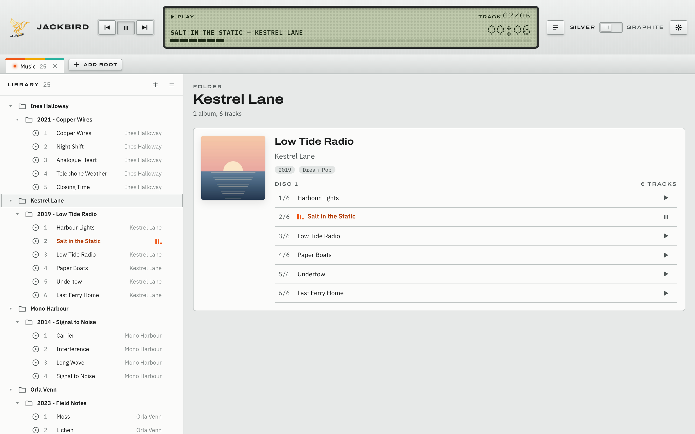
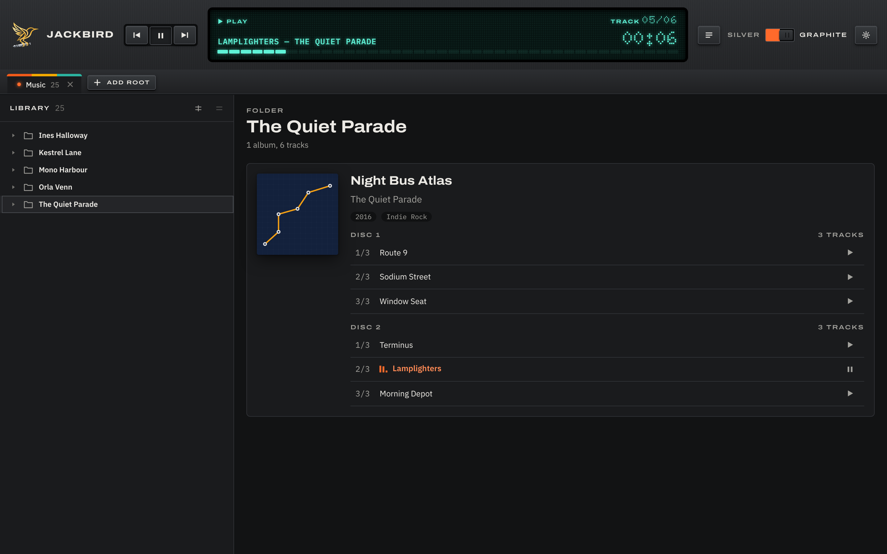
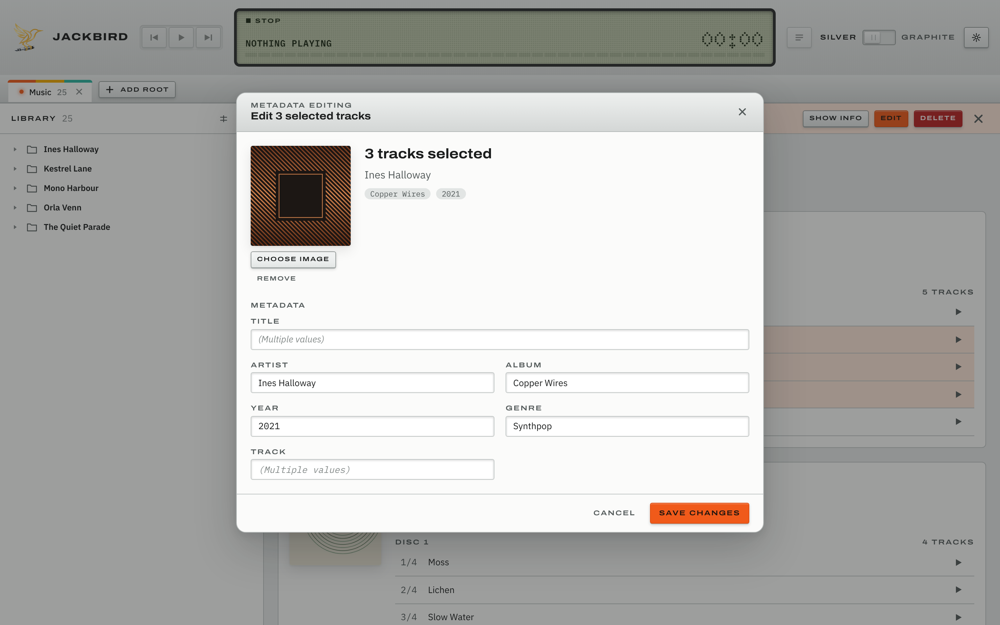
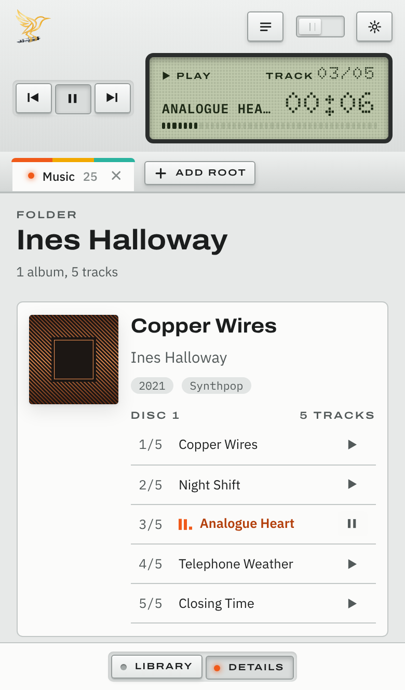

<p align="center">
  
</p>

<h1 align="center">jackbird</h1>

<p align="center"><strong>Your library, right where it is.</strong></p>

jackbird is a browser app for a local MP3 collection. Open a music folder and it lays out your
albums with their covers, plays them, and lets you fix their tags and covers, one track or many at
once. Changes are written straight into your MP3 files: there is no server, and nothing is
uploaded anywhere.

Its interface, **Deck**, takes after old portable audio gear: keys that travel when pressed, a
dot-matrix display, labels printed like a faceplate's, and two tones, Silver and Graphite.

## Screenshots



| Graphite | Editing three tracks at once |
| --- | --- |
|  |  |

<p align="center">
  
</p>

<sub>The albums, artists and covers in the screenshots are made up.</sub>

## Quick start

You need [Node.js](https://nodejs.org/) 22.6 or later and a Chromium-based desktop browser
(Chrome, Edge, Brave, Opera). jackbird reads and writes your files through the File System Access
API, which Firefox and Safari do not have.

```bash
npm install
```

```bash
npm run dev
```

Open <http://localhost:8666>, choose **Open folder** and pick a folder with MP3 files. The browser
asks for permission to edit the files in it; jackbird needs it to save your changes.

Run the checks with `npm test`, and build for production with `npm run build` (into `dist/`).

## Documentation

- [Using jackbird](docs/usage.md)
- [Architecture](docs/architecture.md)
- [Development](docs/development.md)
- [Releases and deployment](docs/releases.md)
