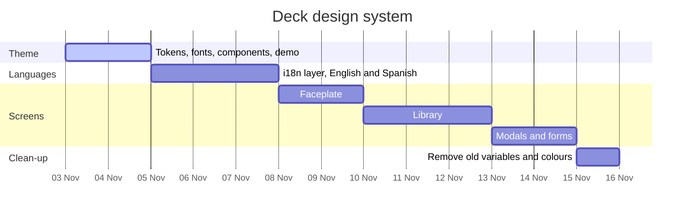

# Deck design system and languages

What is planned, in order. The reasoning lives in
[RECORD/2026-11-03.deck-design-system.WIP.md](../../RECORD/2026-11-03.deck-design-system.WIP.md).

| Step | Scope | Done when |
| --- | --- | --- |
| Theme | `theme/default/`: `tokens.css`, fonts, components, demo at `/theme/default/` | the demo shows every component in both tones; `npm run build` passes |
| Languages | i18n layer with English and Spanish dictionaries, English fallback, language in Preferences | the current Spanish strings are English in source with Spanish translations |
| Faceplate | top bar, `PlaybackBar`, `RootTabs`, `ThemeToggle` | they use theme components and no old variables |
| Library | `TrackWizardList`, `AlbumOverview`, `DetailActionBar`, scan progress | same |
| Modals and forms | `MetadataEditModal`, `MetadataEditor`, `TrackInfoModal`, `PreferencesModal` | same |
| Clean-up | `src/styles.css` | no old colour variables and no hard-coded colours remain |
