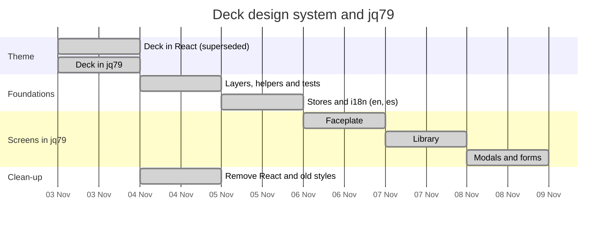

# Deck design system, jq79 and languages

What is planned, in order. The reasoning lives in
[RECORD/2026-11-03.deck-design-system.WIP.md](../../RECORD/2026-11-03.deck-design-system.WIP.md).
Rewritten the same day the UI moved to jq79: the theme was first built in React (done, then
superseded), and the screens moved to jq79 views one at a time. The last two steps, the dialogs
and the clean-up, were done as one block on 2026-11-04.

| Step | Scope | Done when |
| --- | --- | --- |
| Deck in jq79 | `theme/default/`: components as `.html`, `content.css`, demo at `/theme/default/` | the demo shows every component in both tones; `npm run build` passes |
| Layers, helpers and tests | `src/helpers/` with tests, layer check, coverage floor | `npm test` passes with ≥ 90% lines, branches and functions in `helpers/` |
| Stores and i18n | `lib/` stores for the view's state, preferences (theme, language), i18n with English fallback | the React view reads its state from the stores; Spanish strings are English in source with Spanish translations |
| Faceplate | top bar, playback, root tabs, theme toggle as jq79 views | they render from stores with theme components |
| Library | library tree, album sheet, action bar, scan progress | same |
| Modals and forms | metadata editor, track info, preferences | same |
| Clean-up | React, `src/styles.css` | no React dependency, no old colour variables, no hard-coded colours |
