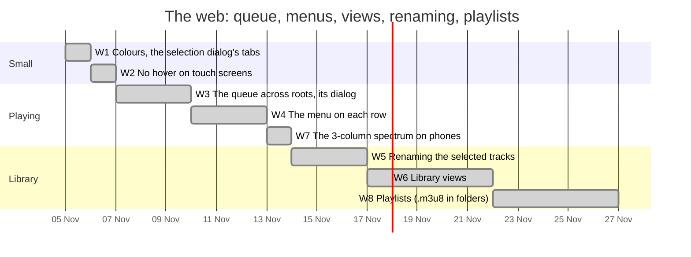

# The web: the queue, a menu per track, library views, renaming, playlists

What is planned for the web app, in order. The reasoning and each step's detail live in
[RECORD/2026-11-04.github-actions-workflows.WIP.md](../../RECORD/2026-11-04.github-actions-workflows.WIP.md)
(extensions of 2026-11-04, 22:00 to 22:20). It starts once E1 of
[rust-tag-engine-and-tauri.md](rust-tag-engine-and-tauri.md) is done; playlists in the family
instance's database come with its F3 ([family-instance.md](family-instance.md)).

Dates are estimates; each step ends with its "done when" met and a walkthrough in the record.
**W1 to W8 are done** (2026-11-04 and 05), in
[jgermade/jackbird#10](https://github.com/jgermade/jackbird/pull/10); where they stand is in the
record (2026-11-05, 01:26). Changed on the way at the owner's request: the queue's dialog after W4
(drag, covers, a panel above the footer on phones), and during W8 the library's head (the view keys,
then the track count), a sub-modal instead of a modal over a modal, and the keys' recess shaped to
them. Left to the owner, by hand, as this container cannot check them: a reload with a queue across
two folders (W3), and renaming to names with non-ASCII characters on a real folder (W5).

| Step | Scope | Done when |
| --- | --- | --- |
| W1 Colours (**done**, 2026-11-04) | the stripes in the order green, orange, red (open tab, brand stripes, splash); the selection dialog's tabs Info, Edit, Rename, Delete, each with its colour on top | the four places read green, orange, red in both tones, and the dialog's tabs are in that order with their colours |
| W2 No hover (**done**, 2026-11-04) | every `:hover` inside `@media (hover: hover)`, held by `npm test`; a track's ▶ and ⋮ always shown on touch screens | on an emulated phone a tap changes nothing but the pressed state, and every track shows its ▶ and ⋮ |
| W3 The queue (**done**, 2026-11-04) | queue items carry their root; play next, add to queue, remove, move, clear upcoming; the list key opens the queue's dialog (with "Show in library") | a queue from two roots plays through, survives a reload, and its dialog plays, moves and removes tracks |
| W4 The menu (**done**, 2026-11-04) | a `menu.html` theme component; ⋮ on tracks and folders: play next, add to queue, go to album and artist (with W6), show in folder, edit, info, rename, remove | every item works from the mouse, the keyboard and a phone, in both languages |
| W7 Spectrum (**done**, 2026-11-05) | three bands at the left of the display's title on phones, while the music plays | on a phone the columns move with the music and fall when it pauses |
| W5 Renaming (**done**, 2026-11-05) | the Rename tab: a `%field%` pattern with presets, a preview with clashes flagged, renames through the VFS with the library, `.meta/`, selection and queue following | the sample library renamed with `%track% - %title%`, still playing, reopened without re-reading a file |
| W6 Views (**done**, 2026-11-05) | Files, Playlists, Artists, Albums by artist, Albums, Compilations, Songs, as tree rows of the active root | each view lists the sample library correctly, plays, selects and opens in Details |
| W8 Playlists (**done**, 2026-11-05) | `.m3u8` files in the folder behind one playlist interface; the Playlists view; "Add to playlist…"; the queue saved as a playlist | a playlist made in jackbird opens in VLC, and one made there opens in jackbird |

Noted, decided separately: iPod sync (a spike of its own), mp3tag's pattern functions, moving files
into folders by pattern.
