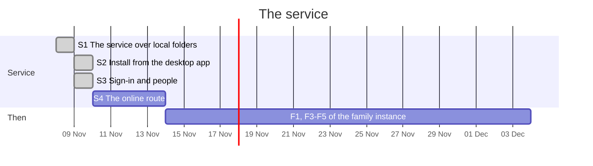

# The service

The family instance's backend (F1) as a service of its own: one binary with no window, serving
the library over HTTP to its two interface clients, the web and the desktop app. The desktop app
carries the same core and works without it; from its interface it installs the service, and is
then only an interface. The reasoning is in
[RECORD/2026-08-11.musikmatch-rust-migration.WIP.md](../../RECORD/2026-08-11.musikmatch-rust-migration.WIP.md)
(2026-11-08, 13:55 to 15:01; the order approved by the owner after E4).

The S steps come right after E4 of [rust-tag-engine-and-tauri.md](../2026-11-04/rust-tag-engine-and-tauri.md),
before E5 and E6, and before the rest of [family-instance.md](../2026-11-04/family-instance.md),
whose F2 (people and sign-in) S3 takes over. Each step is usable on its own. Dates are estimates;
each step ends with its "done when" met and a walkthrough in the record.

| Step | Scope | Done when |
| --- | --- | --- |
| S1 The service (**done**, 2026-11-08; CI on the three systems, the owner's run by hand pending) | `crates/core` behind HTTP (axum) over local folders: the desktop's operations (walk, inspect, save, small files), ranged reads for playback, the web build served from it; one person, open, on the machine only | the web, served by the service, opens a folder on the machine, plays, edits and reopens it after a restart of the service, on the three systems |
| S2 Install (**done**, 2026-11-08; CI on the three systems, Windows' "with the system" by hand pending) | from the desktop app: the service's binary put in place and registered the way each system starts things (a systemd user unit, a launchd agent, a Windows service or a task at logon), started, stopped, removed; the app only an interface while it is installed | the desktop app installs the service, uses it, and removes it, on the three systems |
| S3 Sign-in and people (**done**, 2026-11-09; CI on the three systems, the owner's run by hand with a real SMTP and HTTPS pending) | the two switches (sign-in, several people) in the interface; SMTP set up from it; one-time codes by email to sign up and sign in; passkeys on the instance's own address; roles (owners, admins, editors, listeners); the first owner by email and a code, from the interface or the console | with sign-in on, two people with different roles each do what the role allows and nothing more |
| S4 The online route | an outbound SSH connection to an online server, forwarding the service's port (a reverse tunnel, as intergate does), kept up by the service and set up from the interface | the service is reached from outside home through an online server, with nothing opened at home |

S1 and S2 are done (2026-11-08), and S3 (2026-11-09; the plan at 10:45 as amended up to 11:57,
the walkthrough after it). S4, the online route, is next: its plan (record, 2026-11-09, after S3's
walkthrough) awaits the owner's approval.

Decided separately: system users (the service as root, record 14:57), the content-addressed store
and the metadata layers (F1), what the desktop app does when the service is installed but stopped.
