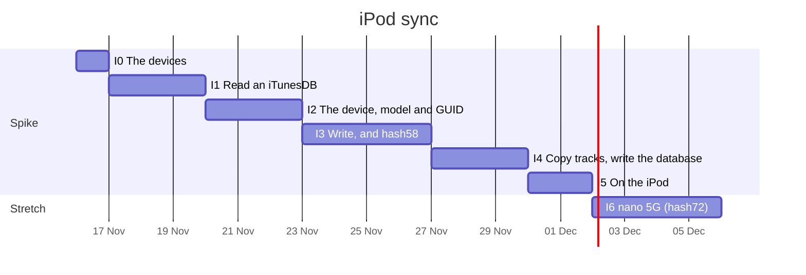

# iPod sync: the iPod nano and the iPod classic

Sending music from jackbird to an iPod that mounts as a disk: the classic (6G to 7G) and the nano
(1G to 4G), and the nano 5G as a stretch. Asked by the owner on 2026-11-04, started as a spike on
2026-11-14 with the owner's focus on the nano and the classic. The reasoning, the models and the
catches are in [RECORD/2026-11-14.ipod-sync.WIP.md](../../RECORD/2026-11-14.ipod-sync.WIP.md).

Each step ends with its "done when" met and a walkthrough in the record. The dates are estimates,
and the steps from I1 on need the owner's iPod at hand.

| Step | Scope | Done when |
| --- | --- | --- |
| I0 The devices | The owner's iPods: model, format (HFS+ or FAT32), synced with iTunes or not, and one to test on. | the list is in the record |
| I1 Read | `crates/ipod` parses an `iTunesDB`; web and desktop list what is on an iPod opened as a root. | the owner's iPod's tracks and playlists are listed as the iPod shows them |
| I2 The device | `SysInfo` and `SysInfoExtended`, the model and its checksum, the GUID (desktop: USB serial; web: `SysInfo`, WebUSB or typed), detecting HFS+. | the GUID and model are found from the desktop, and from the web by at least one path |
| I3 Write and `hash58` | The writer with a byte-exact round trip, and `hash58`. | `hash58` over the owner's iTunes-written database equals the one iTunes stored |
| I4 Copy and write | MP3s under `iPod_Control/Music/Fnn/`, added to the database and a playlist, with a backup and an atomic rename; the iPod panel in the UI. | the new database is written and read back by `crates/ipod` |
| I5 On the iPod | Tested on the owner's classic, then on a nano 3G or 4G. | the tracks and the playlist play on both, and iTunes still opens the iPod |
| I6 Stretch: nano 5G | `hash72`, and whether the SQLite databases are needed too. | the owner decides whether to go on |

Not in it: artwork, play counts, podcasts, AAC and ALAC, FLAC conversion, deleting from the iPod,
the shuffle, the nano 6G and 7G (`hashAB`), the iPod touch and the iPhone.
