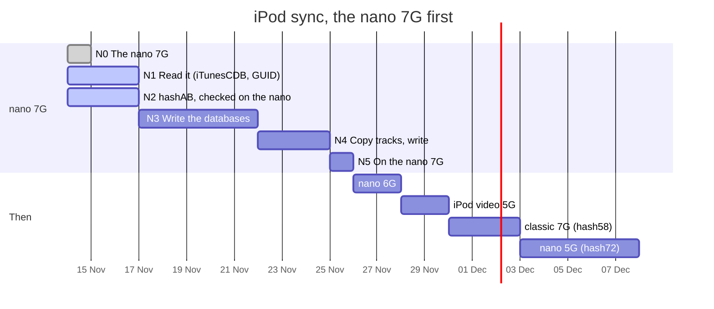

# iPod sync: the iPod nano and the iPod classic

Sending music from jackbird to an iPod that mounts as a disk, on the owner's own devices, starting
with the nano 7G at the owner's ask (2026-11-14), then the nano 6G, the iPod video 5G, the classic
7G and the nano 5G. The nano 1G–4G share the classic's format and work in the code, but no device
here tests them. Asked by the owner on 2026-11-04, started as a spike on
2026-11-14 with the owner's focus on the nano and the classic. The reasoning, the models and the
catches are in [RECORD/2026-11-14.ipod-sync.WIP.md](../../RECORD/2026-11-14.ipod-sync.WIP.md).

**Progress (2026-11-14):** N0 done, except the disk's format (which does not matter on macOS). N1
and N2 are coded and tested without the device (`crates/ipod`, `crates/ipod-usb`, `ipod-info`;
`hashAB` checked against dstaley's vectors and C). Both now wait for the check on the owner's nano,
which continues in a Claude Code session on the owner's Mac (see the record's handoff entry). The
web writing too was approved on 2026-11-14.

Each step ends with its "done when" met and a walkthrough in the record. The dates are estimates,
and the steps from N1 on need the owner's nano at hand.

| Step | Scope | Done when |
| --- | --- | --- |
| N0 The nano 7G | Capacity, format (HFS+ or FAT32), synced with iTunes or not, can it be restored. | it is in the record |
| N1 Read it (coded; the device check is pending) | `crates/ipod` reads `SysInfo` and the `iTunesCDB` (zlib); the desktop app reads `SysInfoExtended` (`sg_inq`, or its copy on the device) and the GUID; web and desktop list the nano's tracks. | the tracks and playlists are listed as the nano shows them, and the GUID is known |
| N2 `hashAB` (coded; the device check is pending) | Ported from dstaley/hashab (public domain), its 100 vectors; checked on the nano's own `iTunesCDB` and `Locations.itdb.cbk`. | the signature iTunes wrote validates |
| N3 Write the databases | The `iTunesCDB` writer and its signature, the SQLite library with the nano's post-process SQL, `Locations.itdb.cbk`. | for an unchanged library, the files match iTunes' in all but the random bytes |
| N4 Copy and write | MP3s under `iPod_Control/Music/Fnn/`, both databases, a playlist, backups and the order of replacing; the iPod panel in the desktop app, then in the web (approved 2026-11-14). | a copy of the nano's files with one track added keeps its tracks, playlists and play counts |
| N5 On the nano 7G | The owner's test on the device. | the tracks play, and iTunes still opens the nano without a restore |
| Then | The nano 6G (same `hashAB` and SQLite), the iPod video 5G (no checksum), the classic 7G (`hash58`), the nano 5G (`hash72`). | each plays on the owner's device |

Writing to a nano 6G or 7G needs `SysInfoExtended` and SQLite. The desktop app reads
`SysInfoExtended` with a USB vendor request (`nusb`), and runs the SQL with `rusqlite`. The web
reads the copy that the desktop app or `ipod-info --save-sysinfo` leaves on the iPod (WebUSB is an
experiment), and runs the same SQL with SQLite compiled to WebAssembly.

Not in it: artwork, play counts shown in jackbird, podcasts, AAC and ALAC, FLAC conversion,
deleting from the iPod, the shuffle, the iPod touch and the iPhone.
