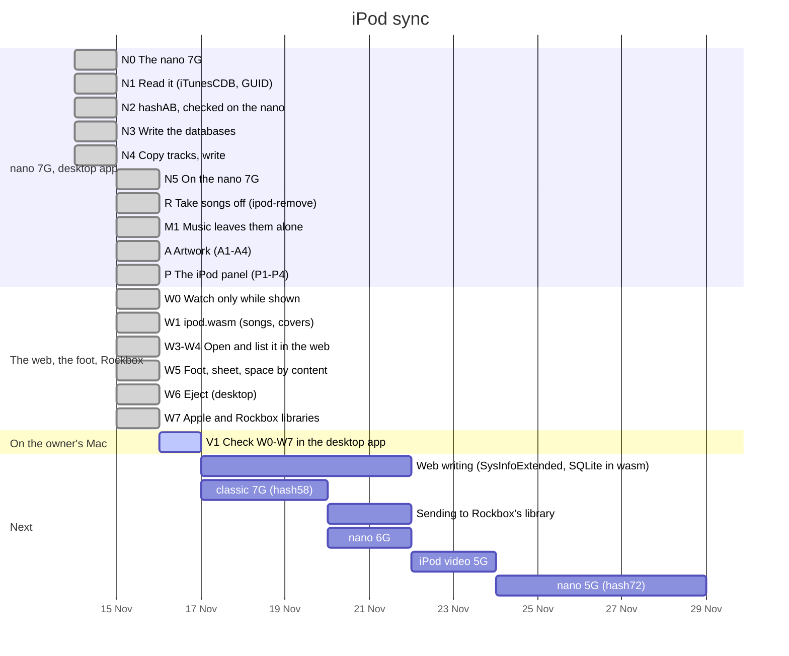

# iPod sync: the iPod nano and the iPod classic

This roadmap covers sending music from jackbird to an iPod that mounts as a disk, on the owner's
own devices.

- **Order.** The nano 7G comes first, at the owner's ask (2026-11-14). Then come the nano 6G, the
  iPod video 5G, the classic 7G and the nano 5G.
- **Untested models.** The nano 1G–4G share the classic's format and work in the code, but no
  device here tests them.
- **History.** The owner asked for it on 2026-11-04, and it started as a spike on 2026-11-14 with
  the owner's focus on the nano and the classic.
- **The record.** The reasoning, the models, the catches and every step's walkthrough are in
  [RECORD/2026-11-14.ipod-sync.WIP.md](../../RECORD/2026-11-14.ipod-sync.WIP.md).

**Progress (2026-11-15, end of the cloud session).**

- **The desktop app on the nano 7G** (N0–N5, artwork, removal, the panel). Done and checked on
  the owner's nano: jackbird's songs play with their covers, Music opens the nano without a
  restore, and songs can be taken off again.
- **The web and the desktop app** (W0–W7). Coded and checked in Chromium (Playwright) on a
  fixture iPod:
  - the iPod opened and listed in a browser;
  - its foot and sheet;
  - a space bar split by content;
  - ejecting;
  - Apple's and Rockbox's libraries.
- **What waits for the owner's Mac (V1).** This session could not compile the desktop app (no
  WebKitGTK), so the desktop app's new commands, and every check that needs a real iPod, wait
  for it.

**Branch.** The work of 2026-11-15 (W0–W7 and the fixes after) is on
`ccr-89c94572-kxlm56`, not merged. The next session continues on a new branch, on the owner's
Mac with Claude Code's CLI. See the record's handoff entry of 2026-11-15 19:00 UTC.

| Step | Scope | Done when |
| --- | --- | --- |
| N0–N5 (done) | The nano 7G read (`iTunesCDB`, `SysInfoExtended`, GUID); `hashAB`; both databases written; MP3s copied; checked on the device. | the songs play, and Music opens the nano without a restore |
| R, M1, A (done) | `ipod-remove`; Music with manual management leaves jackbird's songs alone; covers written to the `ArtworkDB`. | each checked on the owner's nano |
| P (done) | The iPod as a source in the desktop app: listed, opened, played, songs sent and taken off. | checked on the owner's nano |
| W0 (done) | The iPods looked for only while the sources panel shows. | coded; the desktop check is V1 |
| W1 (done) | `crates/ipod-wasm`: the songs, the images, a cover as a PNG (`png` in the module, its speed profile: 2.75 ms a cover). | its Rust and Node tests pass on the fixture |
| W3–W4 (done) | An iPod's drive opened in the browser (Chrome's picker, or Safari's and Firefox's folder input), listed from its database, covers in batches, played from the drive; only read. | checked in Chromium |
| W5 (done) | The iPod's foot in the library (name, space, songs) and its sheet in Details (model, space, counts, firmware, serial, Rockbox, writing); a continuous bar split by content (music, covers, photos, Rockbox, other, free). | checked in Chromium; the desktop's real sizes are V1 |
| W6 (done) | Eject from the desktop app (`diskutil`, `udisksctl`, the shell's verb), from the foot and the sheet; the web says to eject from the system. | coded; the eject itself is V1 |
| W7 (done) | Apple's library or Rockbox's (the drive as Rockbox's database lists it), switched from the foot, remembered per iPod; nothing written to the drive. | checked in Chromium; the desktop and a real classic are V1 |
| V1 | The owner's checks on the Mac, listed in the record's handoff entry (2026-11-15 19:00 UTC). | each passes, or is fixed |
| Web writing | Sending from the web: `SysInfoExtended` from its copy on the iPod (or WebUSB, an experiment), the SQL run with SQLite compiled to WebAssembly. | a song sent from Chrome plays on the nano |
| classic 7G | `hash58` (keyed on the FireWire GUID), the classic's `iTunesDB`, written from the desktop app. | a song sent plays on the owner's classic in Apple's firmware |
| Rockbox sending | With Rockbox's library shown, songs copied into a folder (`Music/<artist>/<album>/`), no database. | Rockbox lists them after its database update |
| Then | The nano 6G (same `hashAB` and SQLite), the iPod video 5G (no checksum), the nano 5G (`hash72`). | each plays on the owner's device |

**How it writes.** Writing to a nano 6G or 7G needs `SysInfoExtended` and SQLite:

- **The desktop app** reads `SysInfoExtended` with a USB vendor request (`nusb`) and runs the SQL
  with `rusqlite`.
- **The web** will read the copy that the desktop app or `ipod-info --save-sysinfo` leaves on the
  iPod (WebUSB is an experiment), and run the same SQL with SQLite compiled to WebAssembly.
- **Rockbox.** It answers no vendor request, so `SysInfoExtended` is read with the iPod in Apple's
  firmware, once.

**Not in it.** Play counts shown in jackbird, podcasts, writing AAC and ALAC, FLAC conversion,
the shuffle, the iPod touch and the iPhone. Reading AAC works: Apple's library lists them, and
the app's tag engine does not read them, so Rockbox's library leaves them out.
