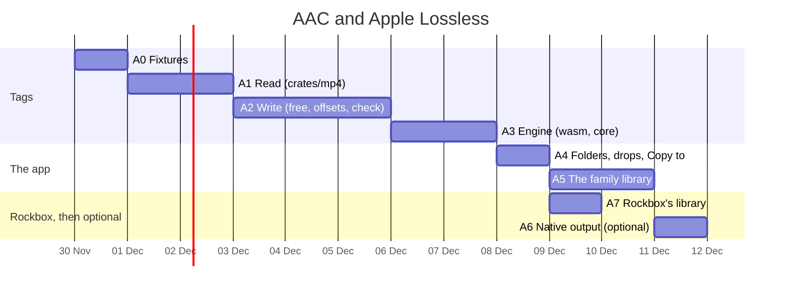

# AAC and Apple Lossless (`.m4a`)

An `.m4a` becomes a track like an MP3 or FLAC: its tags read and written by jackbird's own engine
with its audio untouched, in folders, the library, drops and "Copy to…", and Rockbox's library.
They already play in the desktop app: the native output hands them to the embedded one (the
webview's `<audio>`), so the native output's AAC (A6) is last and optional. Asked for on 2026-11-28: five of six songs on the owner's nano 7G
are AAC and cannot be copied to My music.

- **The plan and its reasons.** [RECORD/2026-11-28.aac-m4a.WIP.md](../../RECORD/2026-11-28.aac-m4a.WIP.md).
- **The hard part.** The tags live in `moov`, which may sit before or after the audio, and whose
  sample tables point into the audio by absolute offsets: a save uses the `free` padding when it
  can, and shifts the offsets when it cannot, never touching the audio's bytes.
- **Not in it.** `.m4p`, video, converting, sending AAC to an iPod (after, with
  ROADMAP/2026-11-14/ipod-sync.md).

**Status.** Proposed; awaiting the owner's approval. The dates below are placeholders.

| Step | Done when |
| --- | --- |
| A0 Fixtures | `.m4a` fixtures built from the specification, with their expectations |
| A1 Read | every fixture and the nano's 1468 AAC files read |
| A2 Write | saves keep the audio's bytes (checked), and Music and `afinfo` still play them |
| A3 Engine | the web's and the desktop's engines on the fixtures |
| A4 The app | "Copy to…" My music takes the nano's AAC songs |
| A5 The library | the nano's 1759 songs in My music |
| A7 Rockbox | the classic's Rockbox library lists its `.m4a` |
| A6 Native output (optional) | AAC and ALAC fixtures decoded bit for bit; exclusive output and gapless for them |
